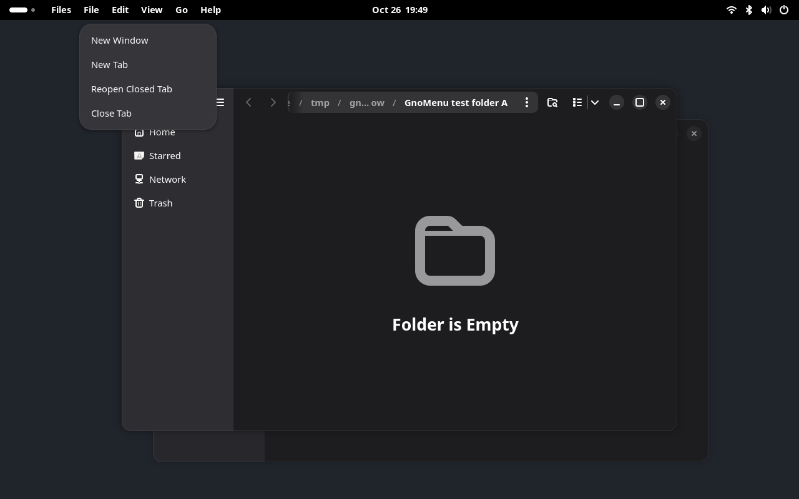
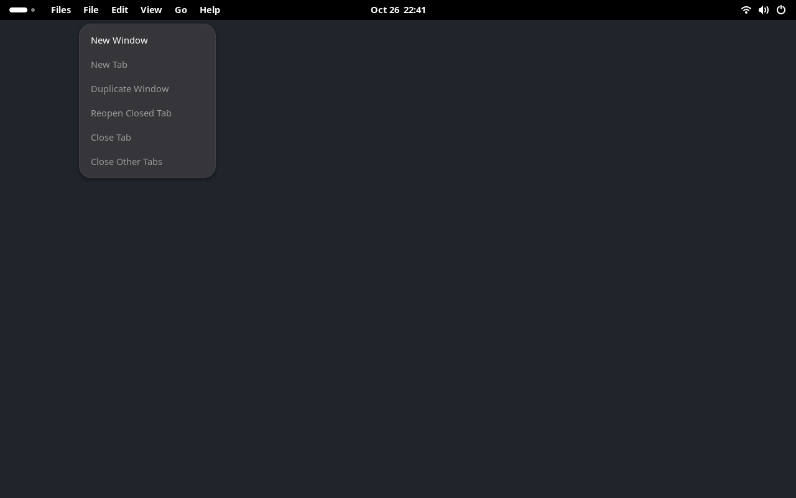

# GnoMenu Global Menu

Application menus in the GNOME top bar, with the application name first.

**Status: pre-release alpha. GNOME Shell 50 on Wayland.** GnoMenu imports exported GMenu models and offers partial action-based menus for Nautilus and Ptyxis. It has not been submitted to extensions.gnome.org.

See the [completion plan](docs/completion-plan.md) for what remains before a public release and broader application support.



## Current support

| Application/source | Status |
| --- | --- |
| Exported GMenu models | Imported menus, sections, submenus, action state and live updates |
| Nautilus 50.4, RPM | Partial menus built from exported application/window actions |
| Ptyxis 50.1, RPM | Partial menus, including the current tab's read-only state |
| Other GTK applications | Original exported menu models and conventional application actions when available |
| Signal, Obsidian, Firefox | Compatibility work remains |
| DBusMenu | Transport, registrar and declared-ID discovery tested in isolation; not connected to the panel |

The [controlled Electron replay](docs/electron-replay.md) verifies actual XWayland export and command routing in our own fixture, and records native Wayland/checkbox limitations. It does not establish Signal or Obsidian support.

Original exported menus normally retain their order, nesting, labels and action targets. The experimental Nautilus integration uses **Files · File · Edit · View · Go · Help** as base categories for captured toolbar/context commands. Additional native menubar menus retain their own headings and nesting before Help, appearing and disappearing with the exported context. Native command labels, typed targets and contextual guards are preserved. An action inventory alone does not describe a menu, so GnoMenu does not generate item captions or a catch-all menu from unplaced action names. See [compatibility and limitations](docs/compatibility.md). A **Partial menu** label identifies the explicit Nautilus/Ptyxis adapters; these are not complete imports of their local menus.

## Desktop and local menus

Every focused application keeps its own name in the panel, including applications without captured commands. When no app has focus, GnoMenu shows Files. Its menus stay bound to the last active Nautilus window, including when the windows are minimized. With no Files window open, the same File, Edit, View, Go and Help categories remain visible. New Window and Home work as launchers; window-dependent commands stay disabled. Application commands such as Preferences remain available while Files publishes them. The extension does not start Files automatically or create hidden windows. Without an installed Files application, the desktop heading reads Desktop.



An imported native menubar is hidden locally when the application exports a boolean window action named `show-menubar`, `show-menu-bar` or `menubar-visible`. Its original state is restored when capture ends or GnoMenu is disabled. Partial adapters and applications without that control retain their local menus. GNOME/Wayland does not provide a general way to remove arbitrary GTK4 or Electron controls from another application.

## Install for your user

For a local source checkout:

```bash
python3 tools/install-local.py
```

Log out and back in to load a newly installed extension on GNOME 50. The installer preserves other extensions and does not end your session.

When migrating from `gnomenu@nilsonpmjr.local`, the installer disables that development identity and enables the public UUID. Its old files are retained; only one GnoMenu identity is enabled.

A packaged ZIP requires GNOME Shell 50; Python, Node.js and gettext build tools are not runtime dependencies. Distribution through GNOME Extensions is pending.

## Try it without changing your desktop

```bash
python3 tools/dev-session.py
```

The development window runs a separate compositor and session bus. Applications opened on your regular desktop do not belong to that window.

To try the real system applications:

```bash
python3 tools/dev-session.py --real-apps
```

The real-app session opens empty temporary folders in Nautilus and runs only `sleep` in the terminal windows. Closing the development window stops its test processes.

On Fedora/Bazzite, if the Mutter viewer is missing:

```bash
python3 tools/bootstrap-devkit.py
```

This downloads a matching Fedora RPM, verifies its signature and extracts the viewer locally. It does not install host packages.

## Experimental Nautilus exporter

An optional [native Nautilus exporter experiment](docs/native-exporter.md) imports its real toolbar, tab, breadcrumb, file-selection, background and Back/Forward history menu models, including widget actions and local-control restoration. It also exposes the native Back/Forward navigation controls under Go, using their actual captions and availability. Commands retain their native context; changes to selection, location or active history slot retire the affected snapshots. History uses the native button captions as additional menu headings. It runs only through the private test/demo harness and is not included in the extension ZIP or enabled by the installer.

Private real-app checks include Copy/Paste and Cut/Paste between two Files windows, plus single-folder Rename through the native filename entry. Renaming also retires commands that still carry the old display name.

## Languages

GnoMenu inherits the session language through gettext. Initial catalogs cover Brazilian and European Portuguese, Spanish, French, German and Italian. English is the fallback.

Application-exported names and menu labels are preserved. Only labels created by GnoMenu are translated. The fixtures deliberately export some Portuguese labels to test that distinction.

To preview a locale without changing your desktop:

```bash
python3 tools/dev-session.py --locale pt_BR.UTF-8
```

See [translation instructions](po/README.md).

## Build and verify

Development dependencies include GNOME Shell 50, GJS, Python/PyGObject, GTK4, gettext, D-Bus tools, Node.js and npm. Real-app checks additionally need Nautilus, Ptyxis and AT-SPI.

```bash
npm ci --ignore-scripts
python3 tools/verify.py
```

The verifier builds the actual ZIP, lints JavaScript, tests both menu transports and localization, and runs the packaged extension in private GNOME sessions with fixtures and real applications. It produces local reports under `reports/`.

To build and inspect the package separately:

```bash
python3 tools/package.py
python3 tools/audit-release.py
```

Artifacts are written to `build/`. Builds are deterministic for identical source/catalog bytes and `SOURCE_DATE_EPOCH`. Tests, research modules, Python helpers and source translation catalogs stay outside the installable ZIP.

## Project documentation

- [Compatibility](docs/compatibility.md)
- [Architecture and lifecycle](docs/architecture.md)
- [Window association research](docs/window-association.md)
- [Experimental menu bridge](docs/menu-bridge.md)
- [Contribution guide](CONTRIBUTING.md)
- [Roadmap](PRODUCT.md)
- [Publishing and GNOME review](docs/publishing.md)
- [Project links and identity](docs/PROJECT.md)

## License

GPL-3.0-or-later. See [COPYING](COPYING) and the source SPDX identifiers.

The local KDE reference checkout is excluded from this repository and from release packages. GnoMenu's shipped implementation is written independently against public GNOME/Gio interfaces.
