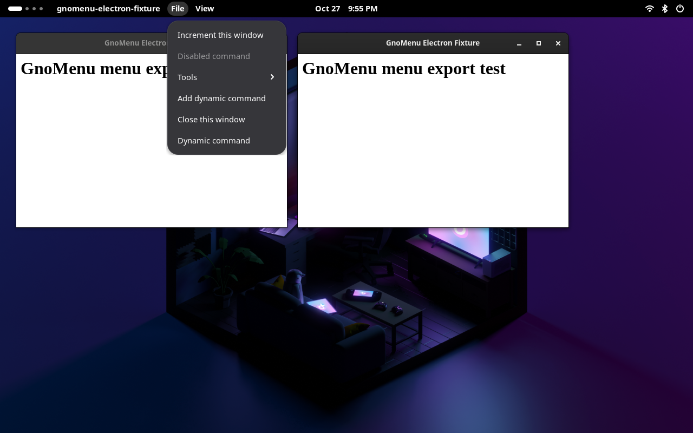

# Electron menus in the private Shell panel

The controlled replay now runs the production GnoMenu renderer alongside the Electron fixture, registrar and experimental companion bridge on a private GNOME desktop. It imports through actual Meta window GTK metadata and displays the native menu headings and commands in the real top bar.

This is a fixture experiment on XWayland, outside Flatpak. It does not establish Signal or Obsidian application support or install a companion in the regular desktop.

For manual mouse/keyboard validation in a visible Mutter window, use the [interactive Electron prototype](electron-interactive.md). Its launch and bridge share the isolated harness; the automatic panel driver does not run in interactive mode.

## Validated behavior

| Trigger | Observed result |
| --- | --- |
| Focus changes between two windows with identical titles and a shared PID | The panel selects the exact GTK window descriptor, keeps File/View headings and closes the previous window's open menu. A retained command from the previous source cannot dispatch. |
| File → Tools is opened while its native contents are still lazy | The actual panel requests preparation; the Nested increment command appears. The parent and child remain open through publication, and invocation changes only the selected native window's counter. |
| Another consumer changes the native model while File is open | The panel imports the new action generation, prepares its current heading and displays Dynamic command. Its actor reaches only the selected native window. |
| The menu is closed while lazy preparation is outstanding | Late native contents arrive without reopening the menu. It remains closed beyond the restoration interval. |

Input in these checks uses actual Shell menu actor APIs through a separate private test observer. It does not simulate physical mouse or keyboard input. General keyboard/pointer checks remain in the existing Shell suite; complete accessibility, physical input, HiDPI and multi-monitor coverage remain pending.

## Renderer changes in alpha 9

`GMenuSource` reads `submenu-action`, checks its window/app action group, availability and boolean state type, then implements `prepare` and `close`. Foreign, copied, disabled, non-menu and obsolete-generation nodes cannot prepare a menu. Source disposal closes surviving submenu actions.

The renderer forwards open/close events for top-level and nested menus. Empty lazy submenus receive a non-actionable placeholder so Shell can open them and request contents. Open state is restored by model path and caption, with parent menus required to be open first. It is never restored by column index or transferred to another source epoch.

D-Bus subscriptions can briefly expose an empty model during replacement. The panel keeps the valid focused source associated while data arrives, invalidates obsolete commands, and retains the requested open hierarchy for at most **500ms**. That interval starts with an explicit menu opening; automatic restoration does not extend it. Explicit closure and focus changes cancel restoration. An actually empty model presents no commands after the bounded replacement interval. Local-menubar ownership keeps the existing capture/release behavior.

The renderer keeps a bounded pool of at most eleven top-level buttons and popup actors for the enabled session, updating captions, accessible names and contents. Unused buttons are hidden; bindings and native source references are replaced on each render. A transient empty model retains the popup briefly with obsolete commands disabled. Restoration waits for anchors and parent popups to be mapped and allocated before opening them. These changes avoid measuring disposed popups or positioning against actors that have just been rebuilt. The pool is destroyed on disable; restoration timers and old menu signal bindings are removed on disable or replacement. Panel destruction also disables the integration, preventing late source callbacks from updating disposed actors during Shell shutdown.

These standard GMenu consumer changes are included in the extension ZIP. The experimental bridge, registrar, X11 property writer and observer remain outside it. A normal installation does not start a registrar, discover arbitrary Electron windows or take over their local menus.

## Reproduce and evidence

Run the command in [the Electron replay guide](electron-replay.md#reproduce). The runner copies the extension into its private data directory, uses a private home/configuration/runtime and D-Bus activation environment, and stops the observer before shutting down Shell. An owned temporary document-portal FUSE mount, if created, is detached before workspace cleanup.

The replay passes fifteen transport/panel groups, seven [X11 identity groups](x11-identity.md) and two bounded native Wayland observations. Its verifier also rejects GJS, JavaScript, Clutter and St critical errors in either Shell log. It records the source hashes, runtime hash and panel screenshot hash in `reports/electron-export/verification.json`. The screenshot is `reports/electron-export/x11/electron-panel.png`.

REA controlled replay Evidence: `ev_350a7fcade60a3a6453517c9a49c6c12a25094f43cdaa1495a56b27e5c71cce5`, exit code 0. The complete inline record is retained locally in `reports/electron-panel-stable-rea.json`. REA verified owned-group cleanup and removal of its temporary capture root; some sampled sandbox processes could not be ownership-inspected through `/proc`. Sampling may miss short-lived processes, selected filesystem snapshots are not syscall traces, and inherited environment or unobserved network activity remains outside complete coverage. This is a bounded replay rather than a long-running stability guarantee.

Third-party identity/lifecycle validation, installable companion packaging, reversible local-menu ownership, actual vendor/Flatpak checks and native Wayland export remain separate work. The previously observed Electron checkbox advertisement mismatch is still present; passing the panel checks does not certify native toggle-state fidelity.
