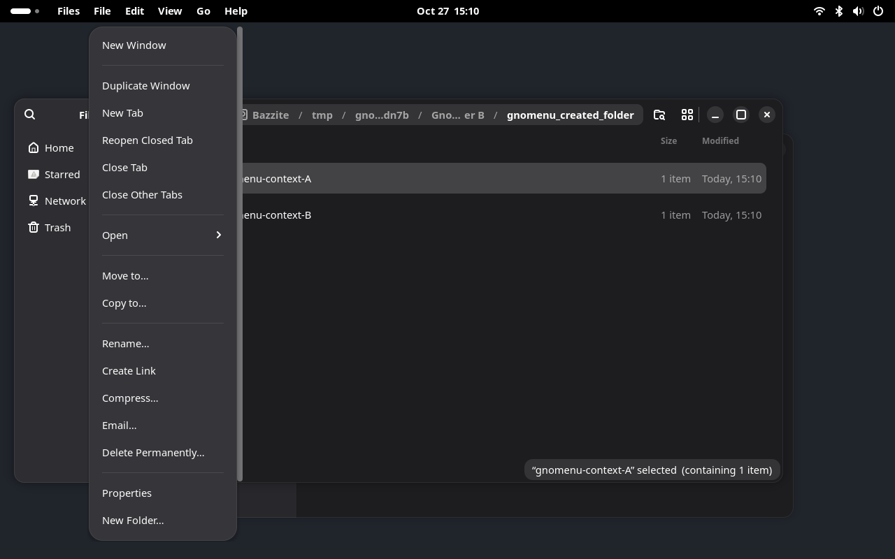
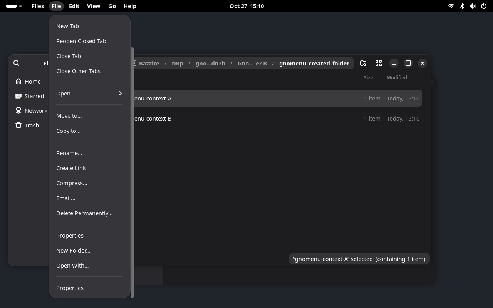
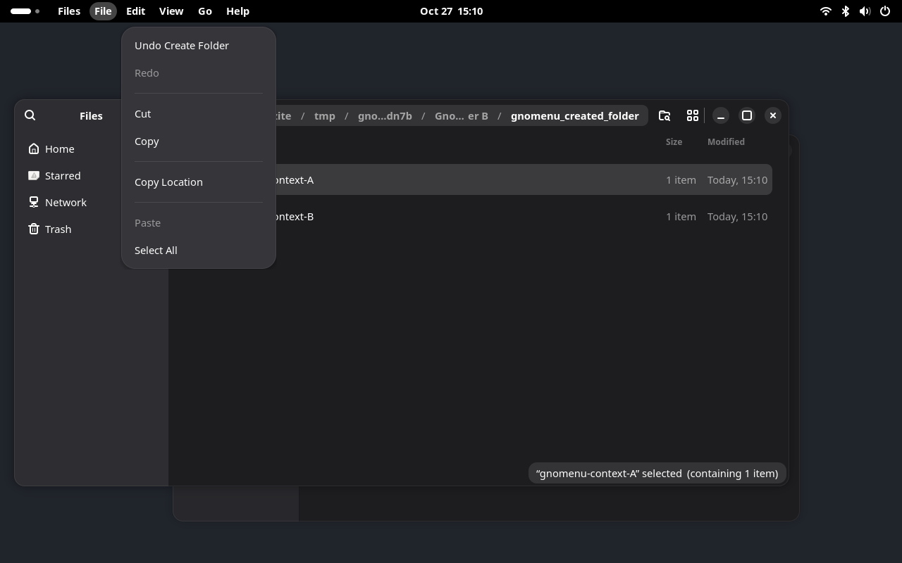
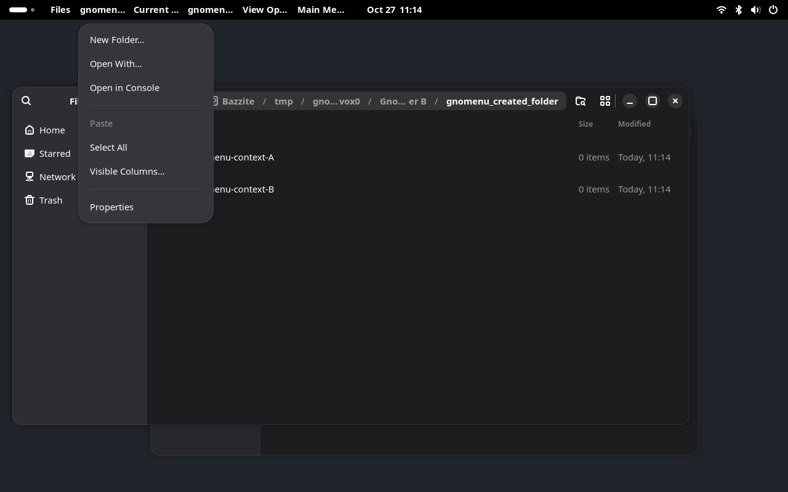
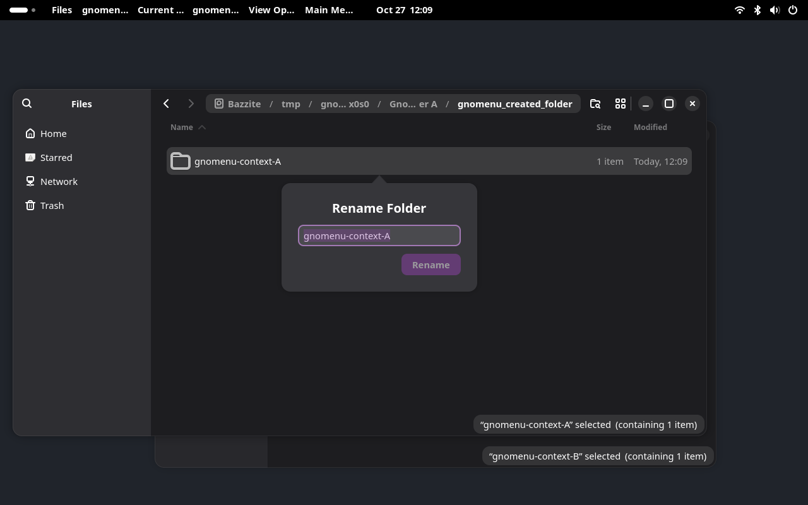
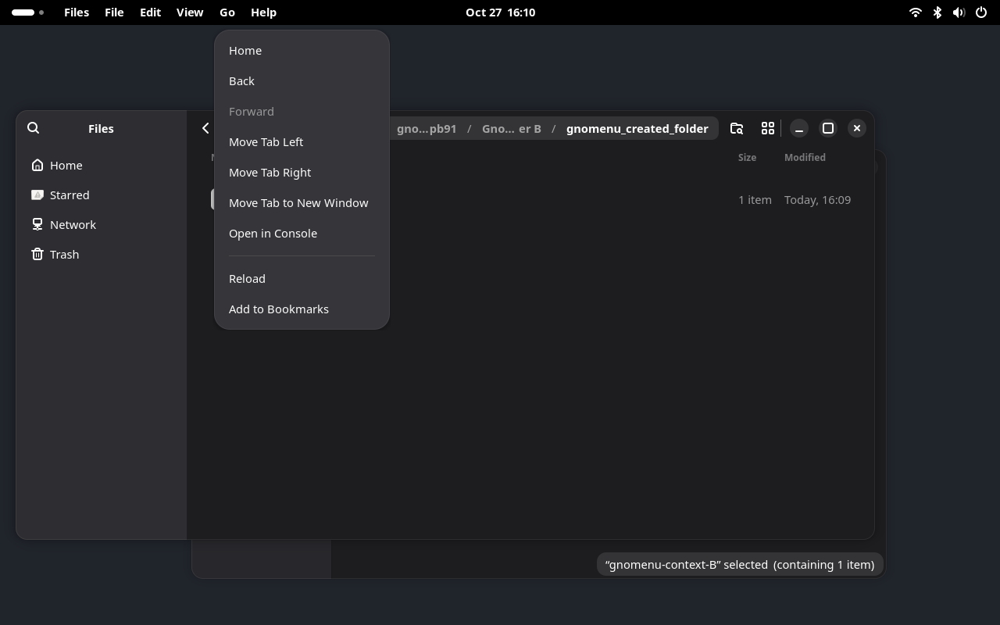
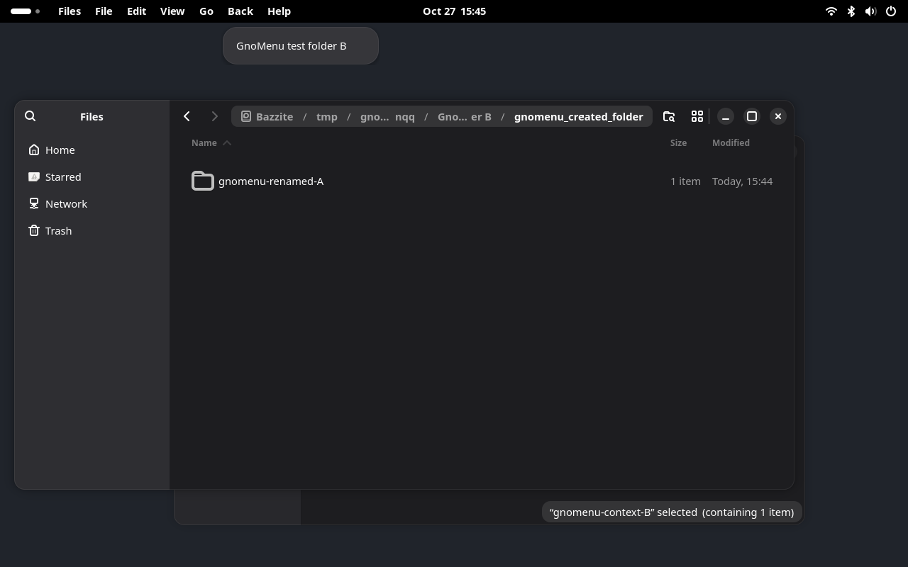
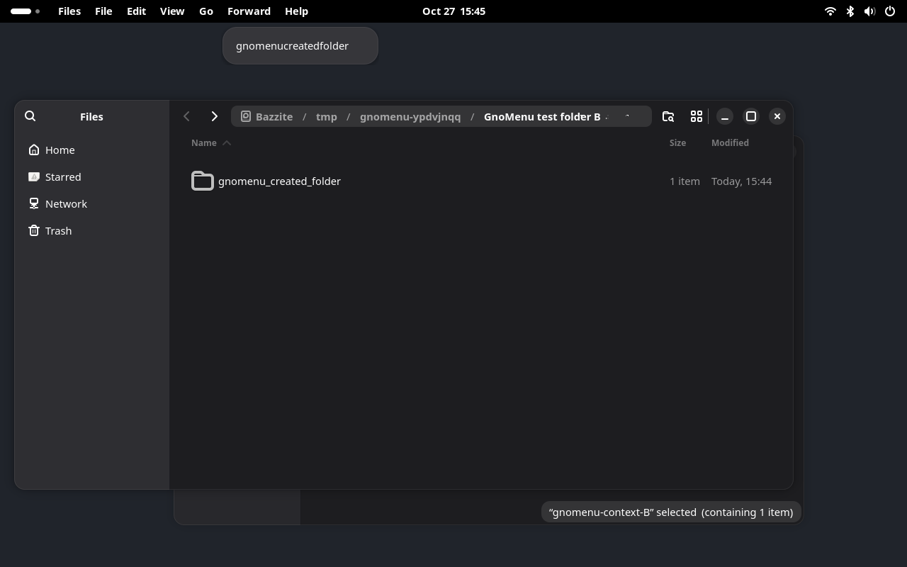

# Experimental Nautilus menu exporter

The optional exporter can import Nautilus 50.4's actual **Main Menu**, **View Options**, **Current Folder Menu**, **tab**, **breadcrumb**, **file-selection**, **background** and **Back/Forward history** menu models into GnoMenu. It also exports the widget actions those models reference, including zoom, sorting, Show Hidden Files, folder creation, bookmarks, reload and indexed history navigation. It does not generate a menu by turning action identifiers into captions.

This is a working experiment for the native RPM application. It is outside the installable extension ZIP and is not enabled by the normal installer. The default Nautilus integration remains the documented partial adapter.

## Files layout

The panel uses **Files · File · Edit · View · Go · Help** as its base layout. Capturing a window places toolbar/context commands into those categories instead of introducing Current Folder Menu, View Options, Main Menu or filename headings in the panel. This is not a closed list: additional native menubar menus keep their actual names and nesting before Help and follow the exported context's lifetime. Native menus matching a base category join it. Empty or fully duplicated extra menus are omitted; no generic commands heading is invented.

- The app name contains native preferences, about and quit actions.
- File contains window/tab operations, opening, folder creation, properties and file operations such as rename.
- Edit contains undo/redo, cut/copy/paste and selection operations.
- View contains the established sidebar/transfers actions plus imported zoom, sorting and display options.
- Go contains the established navigation actions plus native Back/Forward controls, reload/bookmarks and the clicked ancestor's named submenu.
- Help contains native help and keyboard shortcuts.

Imported labels and typed targets are retained. The existing Duplicate Window caption distinguishes cloning the current folder from New Window, which opens Home. Repeated commands are merged by their underlying action and target, preferring a captured selection/tab context over a general fallback. Supported existing commands keep their familiar place. Nested native menus remain nested within the appropriate category; unrecognized imported entries retain their captions under File. Other applications' native layouts are unaffected. Long dropdowns scroll within the monitor work area so added commands remain accessible.

This presentation requires the current extension and exporter. Close and reopen the private demo after updating them.












## Reproduce

On Fedora/Bazzite, use the distribution Python with PyGObject. Build with installed GTK4 development headers:

```bash
/usr/bin/python3 tools/build-native-exporter.py
```

Or build in Podman, without installing development packages on the host:

```bash
/usr/bin/python3 tools/build-native-exporter.py --container
```

Run the automatic real-app checks in inherited locale and Brazilian Portuguese:

```bash
PATH=/usr/bin:/bin:$PATH /usr/bin/python3 tools/verify-native-exporter.py
```

To explore the result in a development desktop:

```bash
/usr/bin/python3 tools/dev-session.py --real-apps \
  --native-exporter build/libgnomenu-gtk4.so
```

The harness creates a private bus, compositor, settings and temporary folders. It passes `LD_PRELOAD` and `GNOMENU_NATIVE_EXPORT=1` only to its Nautilus processes. The Shell, terminal and other fixtures do not load the library. Closing the development desktop stops the test processes. A Nautilus process already running on the user's regular session is not instrumented.

## How it works

1. The library observes the public `gtk_widget_insert_action_group()` calls and records their original widget and namespace. No private GTK struct offsets are used.
2. During application startup, it installs a stable GMenu container before windows publish their GTK D-Bus metadata. An existing application menubar is left to its original exporter.
3. It locates the three supported native menu models on their real menu buttons. Source captions come from the native tooltips. Item labels, sections, targets and nesting come from the original GMenu models. The native zoom custom slots use their actual buttons' tooltips and actions. A model marker selects redistribution into the base Files categories in the extension; additional unmarked native menubar menus retain their own headings.
4. Widget actions get forwarding aliases in the corresponding `GtkApplicationWindow` action map. For example, `view.sort` becomes `win.gnomenu.view.sort`; its original `(sb)` target and state are retained. Invocation resolves the current original group inside that same window, validates the parameter and checks its enabled state.
5. The ordinary GnoMenu GMenu importer reads the standard GTK menu path and exact window action path. No title/PID matching or new Shell-side protocol is required.

The prototype polls native models and states every 200 ms. It copies models without modifying their original contents. A structural change updates the shared menubar model; switching the active application window changes which native models supply that container.

The second iteration handles the header and bottom-bar instances of View Options as two native controls for one exported menu. A newly encountered responsive control joins the existing capture immediately. Generated GTK menubar widgets are excluded from discovery. Forwarding actions are replaced if their original parameter or state type changes, and an empty native model clears its previous export instead of leaving a stale menu.

The third iteration adds the pathbar's Current Folder Menu. Its caption is the native button tooltip, and its `slot.*` actions are forwarded alongside `view.*` actions into the exact window. Nautilus continues to populate its templates, extension sections and action availability. Add/Remove from Bookmarks follows the native state of the current directory, including after switching windows. This is the existing folder-menu model, not a merger of selection or breadcrumb menus.

## Tab context

With at least two tabs, the exporter also reads the actual `AdwTabView` menu model through its public GObject properties. Its exported context label is the target page's real title, with literal underscores escaped for GMenu mnemonic handling. The extension retains that identity on the commands and places them under File and Go. It adds no generic commands category or synthesized action captions.

The default target is the selected page. Nautilus's native `setup-menu` signal supplies the clicked page when the user opens a tab context menu, including an inactive page. The exporter keeps a weak reference to that page after the local popup closes; selecting another tab clears this retained context.

Each page gets distinct forwarding action names, such as `win.gnomenu.tab.8.close-current-view`. Before activation, the exporter verifies that the page still belongs to the same tab view. It asks Nautilus to prepare the menu for that exact page, checks the original action's current availability and parameter type, invokes it, then restores the previous native menu context. Internal preparation does not replace the remembered user context. If a local popup is still open, scanning preserves that popup's original target and availability. Dead pages lose their aliases on the next scan. A closed page's alias cannot be reassigned to a new page.

The native tab strip and its right-click popup remain available. This iteration does not suppress tab context popups or hide navigation controls. The three captured toolbar menus retain their separate hiding/restoration lifecycle.

## Breadcrumb context

The fifth iteration captures the original three-item menu of a clicked ancestor in the pathbar. Nautilus keeps the target file privately, so the exporter observes its public `gtk_popover_set_pointing_to()` and `gtk_popover_popup()` calls. The pointing rectangle identifies the actual breadcrumb button through public widget bounds. The native popup request indicates that Nautilus has prepared its file metadata. The exported label comes from that button's real tooltip, with literal underscores escaped for GMenu labels; the extension keeps it as a named submenu inside Go.

The exporter does not read Nautilus's private structures or reconstruct folder paths from captions. It forwards the original `pathbar.*` actions only while the captured button remains mapped under its original pathbar and the popup's context generation still matches. Each new pointing request immediately invalidates the previous generation, before Nautilus changes its target or waits for metadata. Commands become available for the new generation only after its popup request. Aliases include the generation, for example `win.gnomenu.pathbar.2.open-item-new-tab`.

This requires an actual native right-click. It does not create menus for every ancestor in advance. Missing tooltips or unrecognized buttons leave capture unavailable. The native breadcrumb buttons and local popup remain available; this prototype does not reroute or suppress their native interactions.

## File selection and background context

The sixth iteration captures the actual selection/background models when Nautilus requests their native popups. It reads the view's exposed GObject properties for location, loading and selection. The selection property's list ownership and the selected objects' `display-name` property are verified against the matching Nautilus 50.4 source. These application properties are not a stable cross-version GTK API; no private struct offsets are read.

Each popup gets a new action namespace, such as `win.gnomenu.files.4.view.open-item-new-tab`. The capture holds the selected file objects and location, and refers weakly to the native view/popup. Invocation checks the current location, loading state, exact ordered selection and current popup identity before reaching the original action group. Effective changes retire the capture; selecting the same files again does not revive a retired generation. Redundant notifications that leave the full context unchanged do not retire it. A new popup request replaces the previous context.

Selection context labels use the native display names, joined with commas for multiple files; background labels use the actual native window title. They are retained as command context metadata within the base categories. Literal underscores remain literal. The current limit is 128 selected objects; larger selections are left to the local menu. Command labels, nested menus, parameters and availability come from the original GMenu/GAction models, including the original rules for hiding unavailable commands. The explicit Files presentation determines their category.

The native context popups remain available. Capture requires a native popup request, and a changed context requires reopening it. This establishes the model families, not full validation of every command, file type or extension-provided menu.

The seventh iteration also retires a capture when a selected object's native `display-name` changes. A rename can retain the same file object and selection; pointer identity alone therefore cannot keep the panel heading correct. The exporter watches the native property notification and disconnects those handlers when releasing the capture. Reopening the menu captures the new name with fresh aliases.

## Local controls

When all three supported menus have resolved their actions and custom slots, the library exposes a boolean `win.show-menubar` action. GnoMenu's existing capture lifecycle uses it to hide the original menu buttons, including a responsive duplicate when present. The original visibility flags are restored when capture ends or the extension is disabled. Other toolbar controls and uncaptured context menus remain available.

The test checks restoration across two windows and extension disable. This is not a general mechanism for hiding arbitrary GTK or Electron UI.

If a supported model disappears or cannot resolve its actions, the exporter restores the captured buttons and withdraws the visibility action. Shell menu bindings are also removed when their actors are destroyed, including during compositor shutdown.

## Navigation controls

Go exposes Back and Forward directly, without requiring a history popup first. These two entries are an explicit adapter for Nautilus's actual navigation buttons: captions come from their tooltips, and action names/targets come from `GtkActionable`. The exporter forwards those widget actions through the exact window, with enabled states following the active native slot. It does not infer extra commands from an action inventory.

The original navigation buttons remain visible in the toolbar. Only the three captured menu buttons use the separate local-menu hiding lifecycle. The ordinary extension installation still uses the partial adapter; these widget commands require the optional native exporter.



## Navigation history

Right-clicking the native Back or Forward button supplies Nautilus's actual history menu. The exporter retains its heading from the button tooltip, original destination labels and `uint32` index targets. These appear as additional named menus before Help. They are not redistributed into the base categories or generated by enumerating directories.

Each popup request creates fresh `win.gnomenu.history.N.slot.back-n` or `forward-n` aliases. The snapshot records the exact native menu model, controls, active slot and location through GObject properties from the matching Nautilus source. Changing location or the active slot permanently invalidates the snapshot. Invocation checks that identity again before resolving the original widget action group; returning to a previous location does not revive retired aliases. Reopening the native popup captures the updated history.

The navigation buttons and their native popups remain available. Capture is on demand, after an actual native popup request. It does not provide an always-visible history inventory or claim support for other private widget menus. The GObject properties are application-version-specific, not a stable cross-version GTK protocol.





## Validation and evidence

Observed environment: Nautilus `50.4-1.fc44`, GTK `4.22.5-2.fc44`, GNOME Shell `50.6-1.fc44`, Wayland on Bazzite 44.

Fifty-four check groups cover the two locale sessions, alongside six focused layout checks and a live D-Bus test of additional menu arrival, typed command dispatch to the exact window, removal and stale-command rejection. Additional native menus are exercised both with controlled models and with Nautilus's real history popups.

- Original Main Menu/View Options/Current Folder Menu models, native custom zoom entries and tuple targets are imported.
- Show Hidden Files reveals a real hidden test file. Nautilus intentionally shares this preference across its windows; the exporter preserves that behavior.
- A typed sort command changes the selected window's action state while the second directory window retains its previous state. The original state is restored afterward.
- Three cycles of creating and closing a native tab keep Show Hidden Files connected to the current view, verified against the actual hidden file.
- Resizing to narrow and wide layouts preserves working commands without duplicate headings.
- Native keyboard shortcuts switch between list and grid views. The imported menu follows the native Visible Columns/Captions availability, and hidden-file commands continue to work.
- Add/Remove from Bookmarks changes the native bookmark file under the private XDG config directory. Switching windows preserves the other directory's independent bookmark availability.
- New Folder opens Nautilus's native dialog. Virtual keyboard input completes creation, and the resulting directory exists only under the selected test window's folder. Capture recovers after the dialog closes.
- Tab menu commands move the active page left and right, with availability following the native boundary conditions. The active directory remains selected, and captured context identity preserves literal underscores in the tab title.
- A real pointer right-click targets an inactive tab. After the native popup closes, the panel's Close Tab command closes that page and preserves the active directory. Its aliases are removed, and replaying a retired alias leaves the remaining window intact.
- A real pointer right-click targets the parent breadcrumb while a child folder remains active. The imported Open in New Tab command creates a real background tab for that parent and preserves the active child directory.
- Clicking the workspace ancestor replaces the breadcrumb context. The previous aliases disappear; replaying one does not open a tab for the new target. The new command opens the workspace in a background tab.
- The imported background Select All command selects two real folders. Their native multi-selection menu opens both in actual background tabs, preserving the active directory.
- A native single-selection menu opens only the selected folder in a background tab.
- Replacing selection A with B removes A's aliases. Replaying the retired alias creates no tab; B's newly captured command opens only B.
- Captured Copy and native Paste copy a selected temporary folder to the other Files window. Exact marker contents are checked, the source remains intact and the unselected folder is absent from the destination.
- Captured Cut and native Paste move a different selected folder to the other window. Exact contents arrive, the source disappears and the old selection aliases are retired.
- Captured Rename opens Nautilus's real filename entry. Native keyboard input renames a temporary folder without changing its contents or independent copy. Old name aliases disappear, replay does not reopen a rename entry, and a new popup uses the renamed folder's caption and fresh aliases.
- Fixed Files headings remain in the session language through selection, tab, breadcrumb and filename changes. Captured sorting and clipboard commands appear in View/Edit, navigation in Go, file operations in File, and settings under the app name.
- A real right-click opens Back history; its native heading appears before Help. Reopening replaces the snapshot and retires its old aliases.
- Captured Back and Forward commands retain their native `uint32` targets and navigate the selected window to the expected real folder while preserving the other window. Navigation removes the additional heading and aliases; replaying a retired Back alias has no effect.
- Changing the active native tab retires the previous slot's history aliases and heading.
- Go Back/Forward load without opening a popup. Their captions and enabled states match the actual toolbar buttons observed through the private accessibility bus.
- Go Back navigates to the expected real parent history entry, and Forward returns to the child. Disabled Forward cannot dispatch. Menu availability follows the native buttons after each operation and after switching between two Files windows; the other window retains its own location and availability.
- Original local menu controls return when focus changes to the other window and when GnoMenu is disabled.

On this GTK Wayland build, AT-SPI reports zero screen origins and false selected flags for the native tab objects, and accessible child enumeration does not track visual reordering. The test uses native action availability and the actual window title for movement/selection checks. Pointer input uses the declared private narrow layout, while accessible names and the resulting closed/remaining page establish which tab was targeted. This is not validation of arbitrary themes, scale factors or tab-strip layouts.

Navigation button comparisons use AT-SPI's `SENSITIVE` flag, which follows the real controls in this build. Its `ENABLED` flag remains unset even for usable buttons. The observer records both flags, and `native-navigation-state.json` records the actual comparison rather than treating the missing flag as a disabled command.

Breadcrumb pointer checks use a fixed 1100px layout in the same private compositor. The resulting accessible tab titles establish the opened folder. A real outside click dismisses any remaining native popup grab before interacting with another segment. Properties, Open in New Window, file-renaming/deletion cases and the narrow interval between native context replacement and alias retirement still need dedicated checks.

File-context pointer input uses the same fixed width in list mode, with two temporary test folders. Tab names/count establish open-command targets; marker contents and source/destination existence establish clipboard and rename effects. Clipboard operations stay on the private Wayland compositor. Tests do not exercise deletion, trash, other clipboard formats, batch rename, external application launching, large selections, arbitrary extension menus or the full range of file types and races.

The regular verifier also covers the layout checks without loading the optional library. The extension ZIP includes the presentation policy; the native library remains outside the ZIP and normal installation.

Local artifacts:

- `reports/native-exporter.json`: versions, binary/source hashes and both locale results.
- `reports/dev-session/real-apps/native-exporter/native-model.json`: actual headings, commands, typed targets, owner and exact window paths.
- `reports/dev-session/real-apps/native-exporter/native-menu.png`: imported View Options.
- `reports/dev-session/real-apps/native-exporter/native-main-menu.png`: native application commands under the app heading.
- `reports/dev-session/real-apps/native-exporter/native-current-folder.png`: imported navigation commands under Go.
- `reports/dev-session/real-apps/native-exporter/native-tabs.png`: imported context of a right-clicked inactive tab.
- `reports/dev-session/real-apps/native-exporter/native-tabs-model.json`: observed active directory, target title, tab action aliases/availability and exact window owner/path at capture time.
- `reports/dev-session/real-apps/native-exporter/native-breadcrumbs.png`: imported context of the parent breadcrumb.
- `reports/dev-session/real-apps/native-exporter/native-breadcrumbs-model.json`: observed active/target directory, original labels, action aliases and exact window owner/path.
- `reports/dev-session/real-apps/native-exporter/native-selection.png`: captured single-selection operations under File.
- `reports/dev-session/real-apps/native-exporter/native-selection-scrolled.png`: remaining File commands reached by scrolling.
- `reports/dev-session/real-apps/native-exporter/native-edit.png`: captured clipboard commands under Edit.
- `reports/dev-session/real-apps/native-exporter/native-selection-model.json`: native labels/action aliases, target name and exact window owner/path.
- `reports/dev-session/real-apps/native-exporter/native-background.png`: captured background selection commands under Edit.
- `reports/dev-session/real-apps/native-exporter/native-rename.png`: actual native rename entry before input.
- `reports/dev-session/real-apps/native-exporter/native-clipboard.json`: observed source/destination contents, copy/move/rename results, window paths and alias-retirement evidence.
- `reports/dev-session/real-apps/native-exporter/native-history-back.png` and `native-history-forward.png`: additional menus captured from actual navigation buttons.
- `reports/dev-session/real-apps/native-exporter/native-history.json`: native headings, destination labels, typed targets, scoped aliases and exact window paths.
- `reports/dev-session/real-apps/native-exporter/native-navigation.png`: direct native Back/Forward controls under Go.
- `reports/dev-session/real-apps/native-exporter/native-navigation-state.json`: native button accessibility flags and imported/exported navigation availability at the last comparison.
- `reports/dev-session/real-apps/native-exporter/native-controls-restored.png`: controls after disable.
- `reports/rea-native-exporter.json`: retained REA controlled-replay evidence.

First-iteration REA runtime evidence: `ev_40709176699fc0689d1ef71cd644ee3b97fb9f0953b060cb8653e9b7484ae049`, observed controlled replay, exit code 0. This record covers the original eight groups, not later iterations' expanded checks. The current local verifier records its own source/library hashes and results in `reports/native-exporter.json`. The REA process sampler reached its selected limit and could not inspect some other processes; its process-tree coverage is partial. Its root process group cleanup was verified. The capture does not observe network activity or establish an atomic executable-image binding. The test report and screenshots are evidence for the declared checks, not proof of general compatibility or system-wide behavior.

REA static evidence: `ev_2820ecf786e0d1826f0ea9d3cda77d7eeb00642a5503f44e59624954554f0a53`, with selected export-table view `ev_0e7b92b550e8e288441ea626c1f9fda7f10928cb1b17cf601f45db678d8ef615`. This establishes that the installed GTK binary exports the selected public functions. It does not establish runtime reachability on its own.

## Remaining work

- Validate more file types, clipboard formats, multi-selection cases, extension-provided entries, batch rename and trash/deletion under dedicated temporary fixtures. The main toolbar and context model families are captured; comprehensive command coverage remains pending.
- Validate the remaining breadcrumb commands, context-replacement races, navigation/rename/deletion and responsive layouts while a breadcrumb context is captured.
- Validate tab detachment, restoring closed tabs, closing other tabs, page transfer, keyboard context requests and repeated focus changes while a tab menu is open.
- Extend the bounded tab, view-mode and responsive-layout checks to navigation, background/foreground transitions and long-running stress.
- Exercise parameter/state type replacement with dedicated changing-type fixtures; the replacement guard is implemented but the real-app checks do not force Nautilus to change an action's type.
- Harden model lifetimes and live replacement beyond the validated cases, including disappearance of entire supported menus.
- Define installation, launch and recovery for regular desktop use; current support is the private harness.
- Investigate Flatpak loading and runtime dependencies separately.
- Validate accessibility, keyboard/pointer interaction and additional Nautilus/GTK versions.

These gaps prevent calling this a complete Files exporter or enabling it by default.

## Primary source references

The matching Nautilus source checkout is commit `87bba3cbe6aa2b13a08aebe1330d61c967b1f6d0` (tag `50.4`):

- [Main Menu and window definition](https://github.com/GNOME/nautilus/blob/87bba3cbe6aa2b13a08aebe1330d61c967b1f6d0/src/resources/ui/nautilus-window.blp)
- [View Options and native zoom custom slots](https://github.com/GNOME/nautilus/blob/87bba3cbe6aa2b13a08aebe1330d61c967b1f6d0/src/resources/ui/nautilus-view-controls.blp)
- [Original typed sorting entries](https://github.com/GNOME/nautilus/blob/87bba3cbe6aa2b13a08aebe1330d61c967b1f6d0/src/resources/menu/nautilus-toolbar-view-menu.ui)
- [Current Folder Menu and breadcrumb menu definitions](https://github.com/GNOME/nautilus/blob/87bba3cbe6aa2b13a08aebe1330d61c967b1f6d0/src/resources/menu/nautilus-pathbar-context-menu.ui)
- [Native Current Folder Menu caption and population](https://github.com/GNOME/nautilus/blob/87bba3cbe6aa2b13a08aebe1330d61c967b1f6d0/src/nautilus-pathbar.c)
- [Widget action groups and shared hidden-file preference](https://github.com/GNOME/nautilus/blob/87bba3cbe6aa2b13a08aebe1330d61c967b1f6d0/src/nautilus-files-view.c)
- [Native file display-name property and change notification](https://github.com/GNOME/nautilus/blob/87bba3cbe6aa2b13a08aebe1330d61c967b1f6d0/src/nautilus-file.c)
- [History models, native captions and indexed actions](https://github.com/GNOME/nautilus/blob/87bba3cbe6aa2b13a08aebe1330d61c967b1f6d0/src/nautilus-history-controls.c)
- [Native slot location property and navigation actions](https://github.com/GNOME/nautilus/blob/87bba3cbe6aa2b13a08aebe1330d61c967b1f6d0/src/nautilus-window-slot.c)
