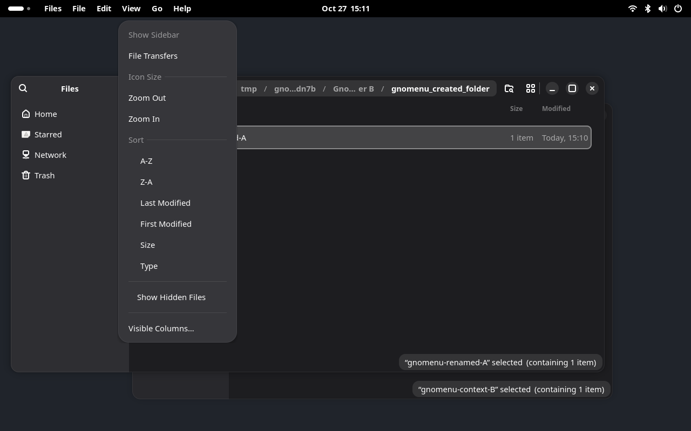

# Experimental Nautilus menu exporter

The optional exporter can import Nautilus 50.4's actual **Main Menu** and **View Options** models into GnoMenu. It also exports the widget actions those models reference, including zoom, sorting and Show Hidden Files. It does not generate a menu by turning action identifiers into captions.

This is a working experiment for the native RPM application. It is outside the installable extension ZIP and is not enabled by the normal installer. The default Nautilus integration remains the documented partial adapter.



## Reproduce

On Fedora/Bazzite, use the distribution Python with PyGObject. Build with installed GTK4 development headers:

```bash
/usr/bin/python3 tools/build-native-exporter.py
```

Or build in Podman, without installing development packages on the host:

```bash
/usr/bin/python3 tools/build-native-exporter.py --container
```

Run the automatic real-app checks in inherited locale and Brazilian Portuguese:

```bash
PATH=/usr/bin:/bin:$PATH /usr/bin/python3 tools/verify-native-exporter.py
```

To explore the result in a development desktop:

```bash
/usr/bin/python3 tools/dev-session.py --real-apps \
  --native-exporter build/libgnomenu-gtk4.so
```

The harness creates a private bus, compositor, settings and temporary folders. It passes `LD_PRELOAD` and `GNOMENU_NATIVE_EXPORT=1` only to its Nautilus processes. The Shell, terminal and other fixtures do not load the library. Closing the development desktop stops the test processes. A Nautilus process already running on the user's regular session is not instrumented.

## How it works

1. The library observes the public `gtk_widget_insert_action_group()` calls and records their original widget and namespace. No private GTK struct offsets are used.
2. During application startup, it installs a stable GMenu container before windows publish their GTK D-Bus metadata. An existing application menubar is left to its original exporter.
3. It locates the two supported native menu models on their real menu buttons. Root captions come from the native tooltips. Item labels, sections, targets and nesting come from the original GMenu models. The native zoom custom slots use their actual buttons' tooltips and actions.
4. Widget actions get forwarding aliases in the corresponding `GtkApplicationWindow` action map. For example, `view.sort` becomes `win.gnomenu.view.sort`; its original `(sb)` target and state are retained. Invocation resolves the current original group inside that same window, validates the parameter and checks its enabled state.
5. The ordinary GnoMenu GMenu importer reads the standard GTK menu path and exact window action path. No title/PID matching or new Shell-side protocol is required.

The prototype polls native models and states every 200 ms. It copies models without modifying their original contents. A structural change updates the shared menubar model; switching the active application window changes which native models supply that container.

The second iteration handles the header and bottom-bar instances of View Options as two native controls for one exported menu. A newly encountered responsive control joins the existing capture immediately. Generated GTK menubar widgets are excluded from discovery. Forwarding actions are replaced if their original parameter or state type changes, and an empty native model clears its previous export instead of leaving a stale menu.

## Local controls

When both supported menus have resolved their actions and custom slots, the library exposes a boolean `win.show-menubar` action. GnoMenu's existing capture lifecycle uses it to hide the original menu buttons, including a responsive duplicate when present. The original visibility flags are restored when capture ends or the extension is disabled. Other toolbar controls and uncaptured context menus remain available.

The test checks restoration across two windows and extension disable. This is not a general mechanism for hiding arbitrary GTK or Electron UI.

If either supported model disappears or cannot resolve its actions, the exporter restores the captured buttons and withdraws the visibility action. Shell menu bindings are also removed when their actors are destroyed, including during compositor shutdown.

## Validation and evidence

Observed environment: Nautilus `50.4-1.fc44`, GTK `4.22.5-2.fc44`, GNOME Shell `50.6-1.fc44`, Wayland on Bazzite 44.

Fourteen check groups cover the two locale sessions:

- Original Main Menu/View Options models, native custom zoom entries and tuple targets are imported.
- Show Hidden Files reveals a real hidden test file. Nautilus intentionally shares this preference across its windows; the exporter preserves that behavior.
- A typed sort command changes the selected window's action state while the second directory window retains its previous state. The original state is restored afterward.
- Three cycles of creating and closing a native tab keep Show Hidden Files connected to the current view, verified against the actual hidden file.
- Resizing to narrow and wide layouts preserves working commands without duplicate headings.
- Native keyboard shortcuts switch between list and grid views. The imported menu follows the native Visible Columns/Captions availability, and hidden-file commands continue to work.
- Original local menu controls return when focus changes to the other window and when GnoMenu is disabled.

The regular 101 check groups also passed without loading the optional library. The extension ZIP includes the Shell actor-lifetime cleanup fix; the native library remains outside the ZIP and normal installation.

Local artifacts:

- `reports/native-exporter.json`: versions, binary/source hashes and both locale results.
- `reports/dev-session/real-apps/native-exporter/native-model.json`: actual headings, commands, typed targets, owner and exact window paths.
- `reports/dev-session/real-apps/native-exporter/native-menu.png`: imported View Options.
- `reports/dev-session/real-apps/native-exporter/native-main-menu.png`: imported Main Menu.
- `reports/dev-session/real-apps/native-exporter/native-controls-restored.png`: controls after disable.
- `reports/rea-native-exporter.json`: retained REA controlled-replay evidence.

First-iteration REA runtime evidence: `ev_40709176699fc0689d1ef71cd644ee3b97fb9f0953b060cb8653e9b7484ae049`, observed controlled replay, exit code 0. This record covers the original eight groups, not the second iteration's expanded checks. The current local verifier records its own source/library hashes and results in `reports/native-exporter.json`. The REA process sampler reached its selected limit and could not inspect some other processes; its process-tree coverage is partial. Its root process group cleanup was verified. The capture does not observe network activity or establish an atomic executable-image binding. The test report and screenshots are evidence for the declared checks, not proof of general compatibility or system-wide behavior.

REA static evidence: `ev_2820ecf786e0d1826f0ea9d3cda77d7eeb00642a5503f44e59624954554f0a53`, with selected export-table view `ev_0e7b92b550e8e288441ea626c1f9fda7f10928cb1b17cf601f45db678d8ef615`. This establishes that the installed GTK binary exports the selected public functions. It does not establish runtime reachability on its own.

## Remaining work

- Capture tab, pathbar, background and selection context menus with their real context and action targets.
- Extend the bounded tab, view-mode and responsive-layout checks to navigation, background/foreground transitions and long-running stress.
- Exercise parameter/state type replacement with dedicated changing-type fixtures; the replacement guard is implemented but the real-app checks do not force Nautilus to change an action's type.
- Harden model lifetimes and live replacement beyond the validated cases, including disappearance of entire supported menus.
- Define installation, launch and recovery for regular desktop use; current support is the private harness.
- Investigate Flatpak loading and runtime dependencies separately.
- Validate accessibility, keyboard/pointer interaction and additional Nautilus/GTK versions.

These gaps prevent calling this a complete Files exporter or enabling it by default.

## Primary source references

The matching Nautilus source checkout is commit `87bba3cbe6aa2b13a08aebe1330d61c967b1f6d0` (tag `50.4`):

- [Main Menu and window definition](https://github.com/GNOME/nautilus/blob/87bba3cbe6aa2b13a08aebe1330d61c967b1f6d0/src/resources/ui/nautilus-window.blp)
- [View Options and native zoom custom slots](https://github.com/GNOME/nautilus/blob/87bba3cbe6aa2b13a08aebe1330d61c967b1f6d0/src/resources/ui/nautilus-view-controls.blp)
- [Original typed sorting entries](https://github.com/GNOME/nautilus/blob/87bba3cbe6aa2b13a08aebe1330d61c967b1f6d0/src/resources/menu/nautilus-toolbar-view-menu.ui)
- [Widget action groups and shared hidden-file preference](https://github.com/GNOME/nautilus/blob/87bba3cbe6aa2b13a08aebe1330d61c967b1f6d0/src/nautilus-files-view.c)
