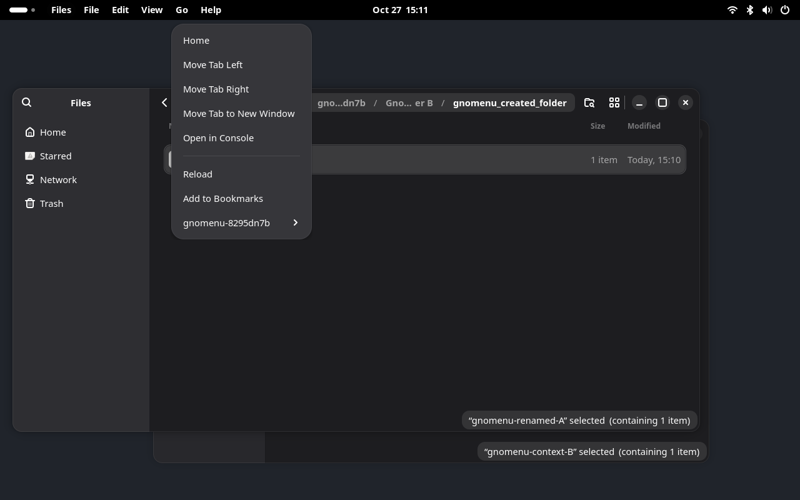
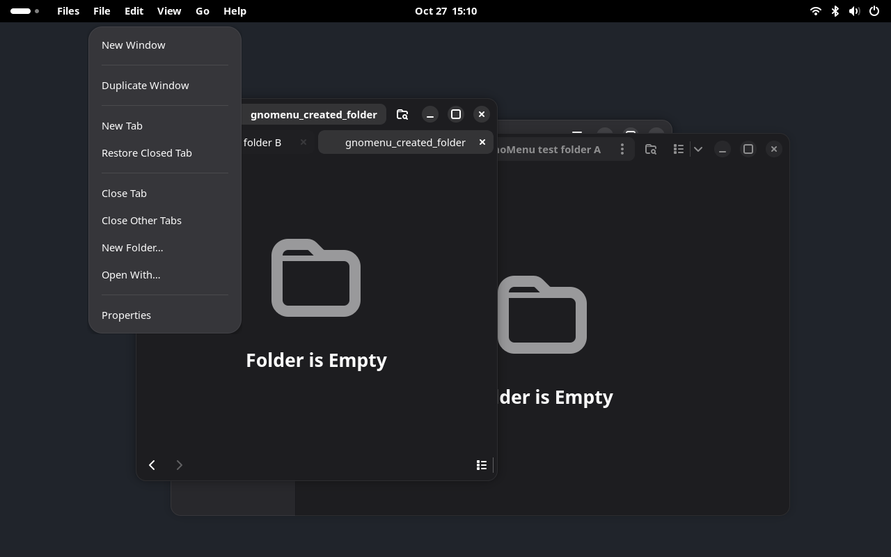
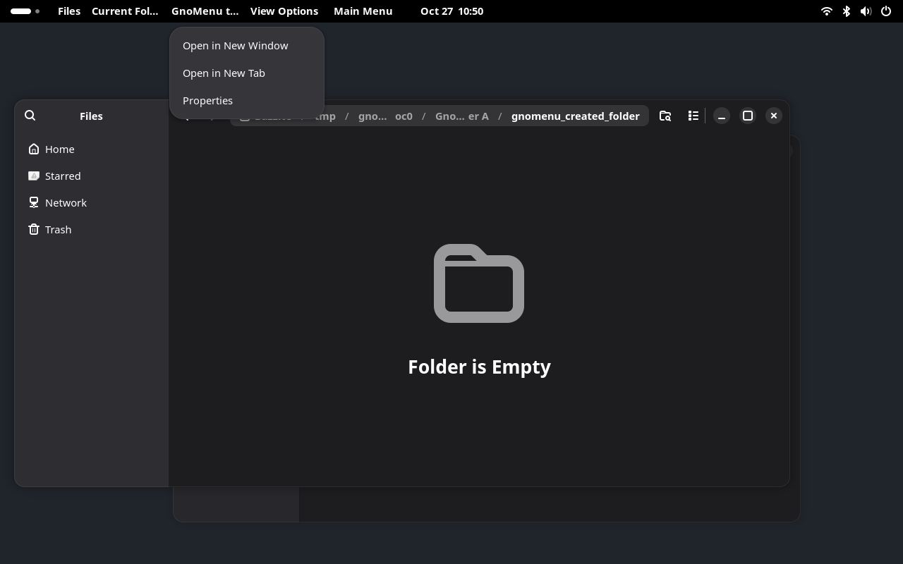

# Experimental Nautilus menu exporter

The optional exporter can import Nautilus 50.4's actual **Main Menu**, **View Options**, **Current Folder Menu**, **tab context menu** and **clicked breadcrumb menu** models into GnoMenu. It also exports the widget actions those models reference, including zoom, sorting, Show Hidden Files, folder creation, bookmarks and reload. It does not generate a menu by turning action identifiers into captions.

This is a working experiment for the native RPM application. It is outside the installable extension ZIP and is not enabled by the normal installer. The default Nautilus integration remains the documented partial adapter.








## Reproduce

On Fedora/Bazzite, use the distribution Python with PyGObject. Build with installed GTK4 development headers:

```bash
/usr/bin/python3 tools/build-native-exporter.py
```

Or build in Podman, without installing development packages on the host:

```bash
/usr/bin/python3 tools/build-native-exporter.py --container
```

Run the automatic real-app checks in inherited locale and Brazilian Portuguese:

```bash
PATH=/usr/bin:/bin:$PATH /usr/bin/python3 tools/verify-native-exporter.py
```

To explore the result in a development desktop:

```bash
/usr/bin/python3 tools/dev-session.py --real-apps \
  --native-exporter build/libgnomenu-gtk4.so
```

The harness creates a private bus, compositor, settings and temporary folders. It passes `LD_PRELOAD` and `GNOMENU_NATIVE_EXPORT=1` only to its Nautilus processes. The Shell, terminal and other fixtures do not load the library. Closing the development desktop stops the test processes. A Nautilus process already running on the user's regular session is not instrumented.

## How it works

1. The library observes the public `gtk_widget_insert_action_group()` calls and records their original widget and namespace. No private GTK struct offsets are used.
2. During application startup, it installs a stable GMenu container before windows publish their GTK D-Bus metadata. An existing application menubar is left to its original exporter.
3. It locates the three supported native menu models on their real menu buttons. Root captions come from the native tooltips. Item labels, sections, targets and nesting come from the original GMenu models. The native zoom custom slots use their actual buttons' tooltips and actions.
4. Widget actions get forwarding aliases in the corresponding `GtkApplicationWindow` action map. For example, `view.sort` becomes `win.gnomenu.view.sort`; its original `(sb)` target and state are retained. Invocation resolves the current original group inside that same window, validates the parameter and checks its enabled state.
5. The ordinary GnoMenu GMenu importer reads the standard GTK menu path and exact window action path. No title/PID matching or new Shell-side protocol is required.

The prototype polls native models and states every 200 ms. It copies models without modifying their original contents. A structural change updates the shared menubar model; switching the active application window changes which native models supply that container.

The second iteration handles the header and bottom-bar instances of View Options as two native controls for one exported menu. A newly encountered responsive control joins the existing capture immediately. Generated GTK menubar widgets are excluded from discovery. Forwarding actions are replaced if their original parameter or state type changes, and an empty native model clears its previous export instead of leaving a stale menu.

The third iteration adds the pathbar's Current Folder Menu. Its caption is the native button tooltip, and its `slot.*` actions are forwarded alongside `view.*` actions into the exact window. Nautilus continues to populate its templates, extension sections and action availability. Add/Remove from Bookmarks follows the native state of the current directory, including after switching windows. This is the existing folder-menu model, not a merger of selection or breadcrumb menus.

## Tab context

With at least two tabs, the exporter also reads the actual `AdwTabView` menu model through its public GObject properties. Its panel heading is the target page's real title, with literal underscores escaped for GMenu mnemonic handling. It adds no generic commands category or synthesized action captions.

The default target is the selected page. Nautilus's native `setup-menu` signal supplies the clicked page when the user opens a tab context menu, including an inactive page. The exporter keeps a weak reference to that page after the local popup closes; selecting another tab clears this retained context.

Each page gets distinct forwarding action names, such as `win.gnomenu.tab.8.close-current-view`. Before activation, the exporter verifies that the page still belongs to the same tab view. It asks Nautilus to prepare the menu for that exact page, checks the original action's current availability and parameter type, invokes it, then restores the previous native menu context. Internal preparation does not replace the remembered user context. If a local popup is still open, scanning preserves that popup's original target and availability. Dead pages lose their aliases on the next scan. A closed page's alias cannot be reassigned to a new page.

The native tab strip and its right-click popup remain available. This iteration does not suppress tab context popups or hide navigation controls. The three captured toolbar menus retain their separate hiding/restoration lifecycle.

## Breadcrumb context

The fifth iteration captures the original three-item menu of a clicked ancestor in the pathbar. Nautilus keeps the target file privately, so the exporter observes its public `gtk_popover_set_pointing_to()` and `gtk_popover_popup()` calls. The pointing rectangle identifies the actual breadcrumb button through public widget bounds. The native popup request indicates that Nautilus has prepared its file metadata. The panel heading comes from that button's real tooltip, with literal underscores escaped for GMenu labels.

The exporter does not read Nautilus's private structures or reconstruct folder paths from captions. It forwards the original `pathbar.*` actions only while the captured button remains mapped under its original pathbar and the popup's context generation still matches. Each new pointing request immediately invalidates the previous generation, before Nautilus changes its target or waits for metadata. Commands become available for the new generation only after its popup request. Aliases include the generation, for example `win.gnomenu.pathbar.2.open-item-new-tab`.

This requires an actual native right-click. It does not create menus for every ancestor in advance. Missing tooltips or unrecognized buttons leave capture unavailable. The native breadcrumb buttons and local popup remain available; this prototype does not reroute or suppress their native interactions.

## Local controls

When all three supported menus have resolved their actions and custom slots, the library exposes a boolean `win.show-menubar` action. GnoMenu's existing capture lifecycle uses it to hide the original menu buttons, including a responsive duplicate when present. The original visibility flags are restored when capture ends or the extension is disabled. Other toolbar controls and uncaptured context menus remain available.

The test checks restoration across two windows and extension disable. This is not a general mechanism for hiding arbitrary GTK or Electron UI.

If a supported model disappears or cannot resolve its actions, the exporter restores the captured buttons and withdraws the visibility action. Shell menu bindings are also removed when their actors are destroyed, including during compositor shutdown.

## Validation and evidence

Observed environment: Nautilus `50.4-1.fc44`, GTK `4.22.5-2.fc44`, GNOME Shell `50.6-1.fc44`, Wayland on Bazzite 44.

Twenty-six check groups cover the two locale sessions:

- Original Main Menu/View Options/Current Folder Menu models, native custom zoom entries and tuple targets are imported.
- Show Hidden Files reveals a real hidden test file. Nautilus intentionally shares this preference across its windows; the exporter preserves that behavior.
- A typed sort command changes the selected window's action state while the second directory window retains its previous state. The original state is restored afterward.
- Three cycles of creating and closing a native tab keep Show Hidden Files connected to the current view, verified against the actual hidden file.
- Resizing to narrow and wide layouts preserves working commands without duplicate headings.
- Native keyboard shortcuts switch between list and grid views. The imported menu follows the native Visible Columns/Captions availability, and hidden-file commands continue to work.
- Add/Remove from Bookmarks changes the native bookmark file under the private XDG config directory. Switching windows preserves the other directory's independent bookmark availability.
- New Folder opens Nautilus's native dialog. Virtual keyboard input completes creation, and the resulting directory exists only under the selected test window's folder. Capture recovers after the dialog closes.
- Tab menu commands move the active page left and right, with availability following the native boundary conditions. The active directory remains selected. The menu heading preserves literal underscores in the tab title.
- A real pointer right-click targets an inactive tab. After the native popup closes, the panel's Close Tab command closes that page and preserves the active directory. Its aliases are removed, and replaying a retired alias leaves the remaining window intact.
- A real pointer right-click targets the parent breadcrumb while a child folder remains active. The imported Open in New Tab command creates a real background tab for that parent and preserves the active child directory.
- Clicking the workspace ancestor replaces the breadcrumb context. The previous aliases disappear; replaying one does not open a tab for the new target. The new command opens the workspace in a background tab.
- Original local menu controls return when focus changes to the other window and when GnoMenu is disabled.

On this GTK Wayland build, AT-SPI reports zero screen origins and false selected flags for the native tab objects, and accessible child enumeration does not track visual reordering. The test uses native action availability and the actual window title for movement/selection checks. Pointer input uses the declared private narrow layout, while accessible names and the resulting closed/remaining page establish which tab was targeted. This is not validation of arbitrary themes, scale factors or tab-strip layouts.

Breadcrumb pointer checks use a fixed 1100px layout in the same private compositor. The resulting accessible tab titles establish the opened folder. A real outside click dismisses any remaining native popup grab before interacting with another segment. Properties, Open in New Window, file-renaming/deletion cases and the narrow interval between native context replacement and alias retirement still need dedicated checks.

The regular 101 check groups also passed without loading the optional library. The extension ZIP includes the Shell actor-lifetime cleanup fix; the native library remains outside the ZIP and normal installation.

Local artifacts:

- `reports/native-exporter.json`: versions, binary/source hashes and both locale results.
- `reports/dev-session/real-apps/native-exporter/native-model.json`: actual headings, commands, typed targets, owner and exact window paths.
- `reports/dev-session/real-apps/native-exporter/native-menu.png`: imported View Options.
- `reports/dev-session/real-apps/native-exporter/native-main-menu.png`: imported Main Menu.
- `reports/dev-session/real-apps/native-exporter/native-current-folder.png`: imported Current Folder Menu.
- `reports/dev-session/real-apps/native-exporter/native-tabs.png`: imported context of a right-clicked inactive tab.
- `reports/dev-session/real-apps/native-exporter/native-tabs-model.json`: observed active directory, target title, tab action aliases/availability and exact window owner/path at capture time.
- `reports/dev-session/real-apps/native-exporter/native-breadcrumbs.png`: imported context of the parent breadcrumb.
- `reports/dev-session/real-apps/native-exporter/native-breadcrumbs-model.json`: observed active/target directory, original labels, action aliases and exact window owner/path.
- `reports/dev-session/real-apps/native-exporter/native-controls-restored.png`: controls after disable.
- `reports/rea-native-exporter.json`: retained REA controlled-replay evidence.

First-iteration REA runtime evidence: `ev_40709176699fc0689d1ef71cd644ee3b97fb9f0953b060cb8653e9b7484ae049`, observed controlled replay, exit code 0. This record covers the original eight groups, not later iterations' expanded checks. The current local verifier records its own source/library hashes and results in `reports/native-exporter.json`. The REA process sampler reached its selected limit and could not inspect some other processes; its process-tree coverage is partial. Its root process group cleanup was verified. The capture does not observe network activity or establish an atomic executable-image binding. The test report and screenshots are evidence for the declared checks, not proof of general compatibility or system-wide behavior.

REA static evidence: `ev_2820ecf786e0d1826f0ea9d3cda77d7eeb00642a5503f44e59624954554f0a53`, with selected export-table view `ev_0e7b92b550e8e288441ea626c1f9fda7f10928cb1b17cf601f45db678d8ef615`. This establishes that the installed GTK binary exports the selected public functions. It does not establish runtime reachability on its own.

## Remaining work

- Capture background right-click and selection context menus with their real context and action targets. Current Folder, tab and clicked breadcrumb models are already captured.
- Validate the remaining breadcrumb commands, context-replacement races, navigation/rename/deletion and responsive layouts while a breadcrumb context is captured.
- Validate tab detachment, restoring closed tabs, closing other tabs, page transfer, keyboard context requests and repeated focus changes while a tab menu is open.
- Extend the bounded tab, view-mode and responsive-layout checks to navigation, background/foreground transitions and long-running stress.
- Exercise parameter/state type replacement with dedicated changing-type fixtures; the replacement guard is implemented but the real-app checks do not force Nautilus to change an action's type.
- Harden model lifetimes and live replacement beyond the validated cases, including disappearance of entire supported menus.
- Define installation, launch and recovery for regular desktop use; current support is the private harness.
- Investigate Flatpak loading and runtime dependencies separately.
- Validate accessibility, keyboard/pointer interaction and additional Nautilus/GTK versions.

These gaps prevent calling this a complete Files exporter or enabling it by default.

## Primary source references

The matching Nautilus source checkout is commit `87bba3cbe6aa2b13a08aebe1330d61c967b1f6d0` (tag `50.4`):

- [Main Menu and window definition](https://github.com/GNOME/nautilus/blob/87bba3cbe6aa2b13a08aebe1330d61c967b1f6d0/src/resources/ui/nautilus-window.blp)
- [View Options and native zoom custom slots](https://github.com/GNOME/nautilus/blob/87bba3cbe6aa2b13a08aebe1330d61c967b1f6d0/src/resources/ui/nautilus-view-controls.blp)
- [Original typed sorting entries](https://github.com/GNOME/nautilus/blob/87bba3cbe6aa2b13a08aebe1330d61c967b1f6d0/src/resources/menu/nautilus-toolbar-view-menu.ui)
- [Current Folder Menu and breadcrumb menu definitions](https://github.com/GNOME/nautilus/blob/87bba3cbe6aa2b13a08aebe1330d61c967b1f6d0/src/resources/menu/nautilus-pathbar-context-menu.ui)
- [Native Current Folder Menu caption and population](https://github.com/GNOME/nautilus/blob/87bba3cbe6aa2b13a08aebe1330d61c967b1f6d0/src/nautilus-pathbar.c)
- [Widget action groups and shared hidden-file preference](https://github.com/GNOME/nautilus/blob/87bba3cbe6aa2b13a08aebe1330d61c967b1f6d0/src/nautilus-files-view.c)
